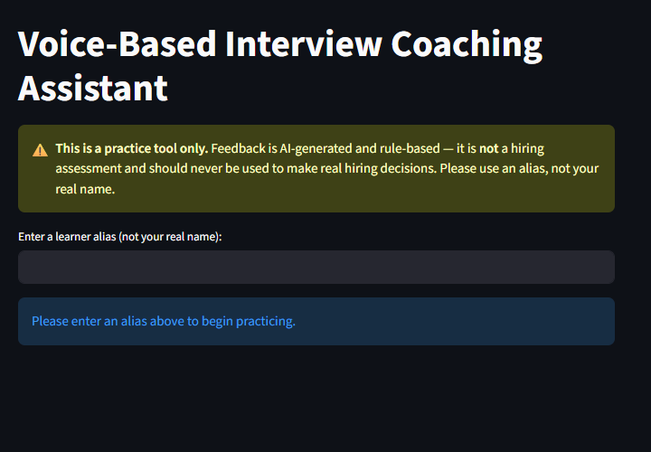
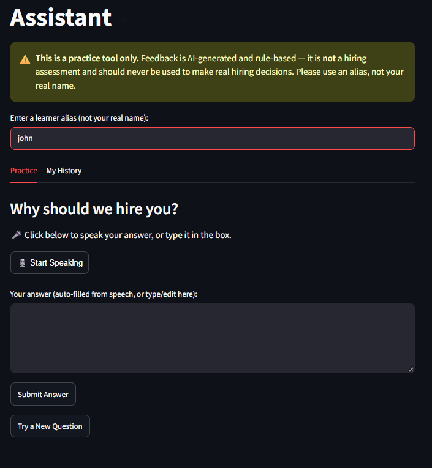
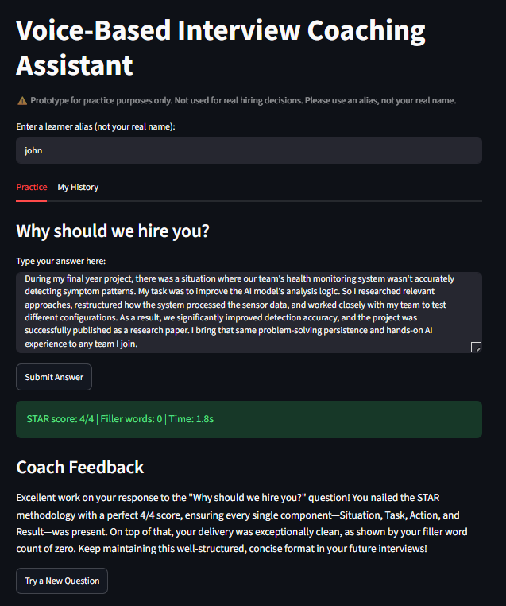
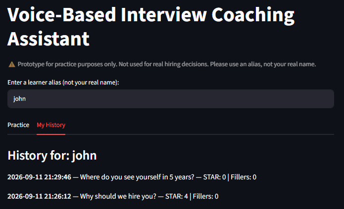

# Voice-Based Interview Coaching Assistant 🎙️

Hey! This is a project I built for my college's AI hackathon. It's a tool that lets you practice interview questions by speaking (or typing) your answers, and get instant feedback on how well-structured your answer is, without needing to find a real person to practice with.

🔗 **Try it live:** https://voice-based-interview-coach-assistant-6ahge3hvomgq3kqkfgctfd.streamlit.app/ 

## Why I built this

Honestly, interview prep is stressful and most people either practice alone with zero feedback, or have to convince a friend to sit through a mock interview with them. I wanted to build something that gives you real, structured feedback instantly, any time you want to practice, privately, without anyone judging you.

## What it actually does

1. You get shown a common interview question
2. Speak your answer out loud (or type it). Your speech gets converted to text right in the browser
3. You can review and fix the text before submitting, since speech recognition isn't always perfect
4. The app scores your answer on:
   - **STAR structure** (Situation, Task, Action, Result), out of 4
   - **Filler words** (um, like, basically, etc.)
5. An AI model (Gemini) then looks at those scores and gives you personalized, written feedback
6. Everything gets saved so you can go back and see your past attempts and track if you're improving

## Tech I used

- **Python + Streamlit** for the app itself
- **streamlit-mic-recorder** for the voice input (uses the browser's built-in speech recognition)
- **SQLite** to save every attempt
- **Google Gemini API** to generate the actual coaching feedback from the scores
- Deployed on **Streamlit Community Cloud**

## A few design choices I made on purpose

- There's a clear disclaimer in the app that this is NOT a real hiring assessment. It's a practice tool only
- The AI only gets sent the *scores* (not your actual answer word for word) when generating feedback. This keeps things more private and grounded in actual evidence instead of the AI making stuff up
- You can edit your transcript before submitting, so a misheard word doesn't ruin your score

## Things I know aren't perfect (yet)

- Voice input only works in Chrome/Edge right now, since it relies on the browser's built-in speech recognition, which Firefox doesn't support the same way
- The STAR scoring works off keyword patterns, not deep language understanding. It's a good signal but not flawless (a strong answer phrased unusually might score lower than it deserves)
- Speech-to-text sometimes mishears words, which is exactly why I added the "review before submitting" step

## Screenshots

## Screenshots







## Want to run it yourself?

```bash
git clone https://github.com/ayesha288/voice-based-interview-coach-assistant.git
cd voice-based-interview-coach-assistant
pip install -r requirements.txt
```

You'll also need your own free Gemini API key. Add it to a `.streamlit/secrets.toml` file like this:

```toml
GEMINI_API_KEY = "your-key-here"
```

Then run:

```bash
streamlit run app.py
```

## A note on AI assistance

I used Claude AI quite a bit while building this, mainly for debugging errors I didn't understand yet, and learning how to work with things like SQLite and the Gemini API for the first time. I've tested everything here and can explain how it works. Claude helped me get unstuck and learn faster, similar to how a lot of developers use AI tools day to day.

## About me

I'm Ayesha, a B.Tech Computer Engineering student at Pillai University, previously did my Diploma in AI/ML.

📎 [LinkedIn](https://www.linkedin.com/in/ayesha-shaikh-8ba770312/) • [GitHub](https://github.com/ayesha288)
